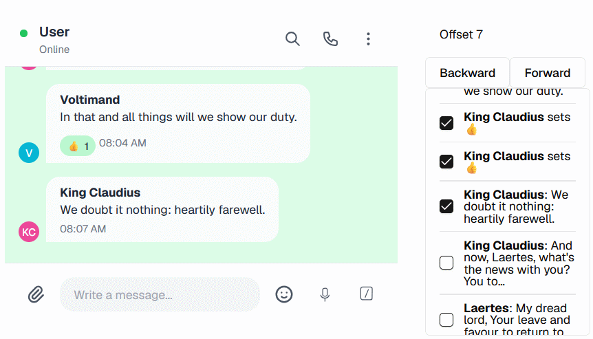

# Telegram Bot API Emulator

[](https://github.com/hoborg91/TgBotApiEmulator/actions/workflows/release.yml)

This is a framework for Telegram bot testing. It allows to decouple the part of development and testing cycle from Telegram infrastructure.

> ⚠ For now only `getUpdates` technique of bot interaction is supported.

## Example: regression testing

You can use the Emulator to record some proper interaction of users with the bot. Once you add new feature to the bot you can run that previously recorded flow to check if the flow is broken. This test can be saved as a Postman collection. Also it can be played in draft version of GUI.

### Phase 1. Prepare Postman collection for regression testing

1. Run the Emulator and your bot. Aim your bot at the Emulator (instead of Telegram servers). The default Emulator address is http://localhost:5134. Now the Emulator will translate the bot calls to Telegram servers, record both the calls and Telegram responses.

<details>

<summary>Docker Compose</summary>

```pwsh
docker compose -f ./src/docker-compose.yml up
```

</details>

<details>

<summary>Raw</summary>

```pwsh
dotnet run --project ./src/TgBotApiEmulator/TgBotApiEmulator.csproj
```

</details>

2. Interact with the bot as usual and utilize the bot functionality which you want to cover by regression tests. Once you done, make Postman collection representing that interaction. Example:

```pwsh
$Env:TOKEN = "1234567891:abcdefghijklmnopqrstuvwxyz123456789"
curl "http://localhost:5134/test/makePostmanCollection/$Env:TOKEN" -o regressionTest.json
```

> `1234567891:abcdefghijklmnopqrstuvwxyz123456789` is an example bot token. Replace it with your token.

### Phase 2. Run regression tests

1. Stop the Emulator to retranslate bot calls to Telegram servers:

```pwsh
curl -X 'PUT' "http://localhost:5134/admin/operatingMode/$Env:TOKEN/Emulator"
```

> **Tip.** If later you want to restore the retranslation, then run: `curl -X 'PUT' "http://localhost:5134/admin/operatingMode/$Env:TOKEN/RecordingProxy"`

2. Run the Postman collection:

```pwsh
postman collection run regressionTest.json --env-var "emulatorUrl=http://localhost:5134" --env-var "botToken=$Env:TOKEN"
```

3. Integrate the Postman collection to your development and testing cycle, if necessary.

4. Play the recorded workflow in the GUI to visualize it.

<details>

<summary>Docker Compose</summary>

Provided you run `docker compose` before, no actions required.

</details>

<details>

<summary>Raw</summary>

```pwsh
npm --prefix ./src/tgbotapiemulator-webgui run dev
```

</details>

<picture>
  <source srcset="./docs/screenshots/gui-general-261014-dark.png" media="(prefers-color-scheme: dark)">
  
</picture>

> **Tip.** Restart your bot after integration testing. Otherwise it may lose some upcoming updates.
